# SGB — Explicación de los diagramas UML

**Sistema de Gestión Bibliotecaria (SGB)** · Programación De Computadores II · Parcial 3
Carlos Santiago Merchan Centeno · Daniel Fernando Vesga Tarazona · Universidad De Santander

Este documento explica, uno por uno, los diagramas UML del proyecto. Todos están en el archivo editable
[`SGB_UML.drawio`](SGB_UML.drawio) (una pestaña por diagrama, con el mismo estilo de la plantilla `uml_cdt.drawio`),
sus imágenes están en la carpeta [`diagramas/`](diagramas/) y el documento para entregar es
[`SGB_Diagramas_UML.pdf`](SGB_Diagramas_UML.pdf).

---

## 0. Antes de leer los diagramas: cómo se representa un programa hecho solo con funciones

El SGB está implementado en Python **sin clases ni objetos**: cada entidad es un **diccionario** y cada
"clase" del diseño del enunciado es un **grupo de funciones con un prefijo común**. Para que los diagramas
correspondan exactamente al código se usan estas convenciones:

| Elemento del diseño | En el código (`SGB.ipynb`) | Cómo aparece en los diagramas |
|---|---|---|
| Entidad del dominio (Usuario, Libro, …) | Diccionario creado por `crear_usuario()`, `crear_libro()`, … | Caja con estereotipo **«dict»** (sus atributos son las claves del diccionario) |
| Clase Repository / Service | Funciones con prefijo: `repo_libro_*`, `prestamo_*`, … | Caja con estereotipo **«module»**; sus operaciones son las funciones |
| Métodos `to_linea()` / `from_linea()` | `usuario_to_linea(u)`, `usuario_from_linea(linea)` | Operaciones del «module» de cada entidad |
| Enums | Tuplas `TIPO_USUARIO_ENUM`, `ESTADO_PRESTAMO_ENUM`, … | Cajas «enumeration» o constantes del módulo `enums_y_validaciones` |
| Objeto (instancia) | Un diccionario concreto leído de un `.txt` | Caja con nombre subrayado `nombre: Tipo` y valores |
| Llamada a un método | Llamada a una función | Dependencia punteada «Use» o mensaje en una secuencia |

**Notación usada (igual que la plantilla):**

* Línea **punteada con flecha abierta y etiqueta «Use»**: un módulo usa (llama funciones de) otro.
* Línea **continua sin flecha** con números en los extremos: asociación con **multiplicidad**
  (`1` = exactamente uno, `0..*` = cero o muchos, `0..1` = cero o uno).
* **«create»**: el módulo construye ese tipo de diccionario.
* En secuencias: flecha **continua con punta rellena** = llamada; flecha **punteada con punta abierta** = retorno;
  rectángulo delgado = **activación** (la función se está ejecutando); marcos **loop**, **alt** y **opt** =
  repetición, alternativa (si / si no) y bloque opcional.
* `+` en una operación = función pública (la usan otras capas); `-` = función interna de la capa de interfaz.

---

# DISEÑO ESTRUCTURAL

## 1. Diagrama de dominio

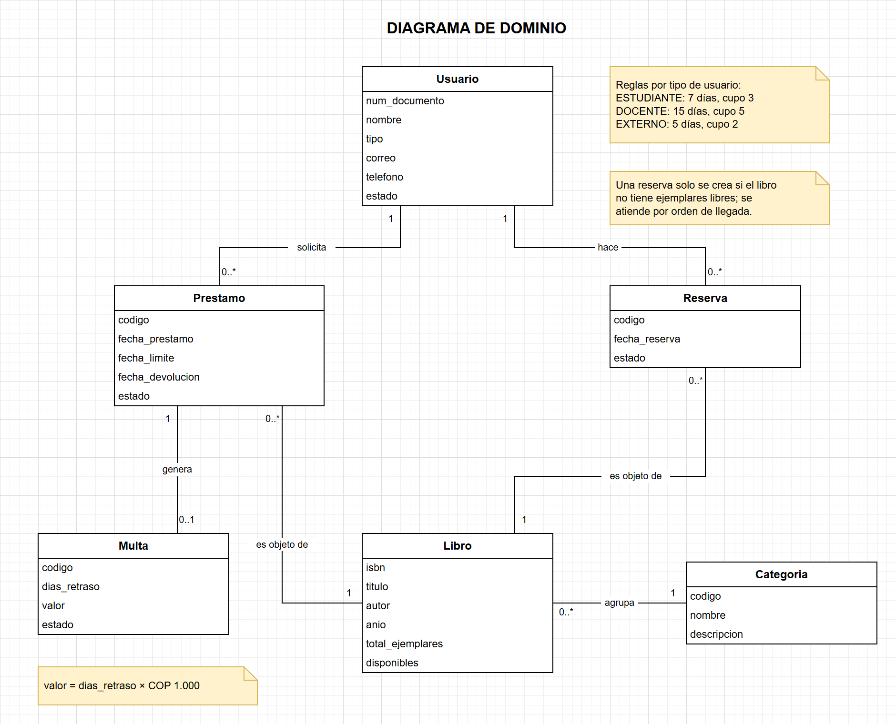

**Qué muestra:** el modelo conceptual del negocio de la biblioteca, sin detalles de programación: las seis
entidades, sus atributos principales y cómo se relacionan.

**Entidades:**

* **Usuario**: persona registrada (documento, nombre, tipo, correo, teléfono, estado ACTIVO/SUSPENDIDO).
* **Categoria**: clasificación de los libros (LIT, TEC, CIE, HIS…).
* **Libro**: título del catálogo con su ISBN y el control de ejemplares (`total_ejemplares` y `disponibles`).
* **Prestamo**: entrega de un ejemplar a un usuario, con fecha de préstamo, fecha límite, fecha de devolución y estado.
* **Multa**: sanción generada por devolver tarde (días de retraso, valor, estado).
* **Reserva**: turno de un usuario para un libro que no tiene ejemplares libres.

**Relaciones y multiplicidades:**

| Relación | Lectura |
|---|---|
| Usuario `1` — `0..*` Prestamo (*solicita*) | Un usuario puede tener muchos préstamos; cada préstamo pertenece a un único usuario. |
| Usuario `1` — `0..*` Reserva (*hace*) | Un usuario puede tener muchas reservas; cada reserva es de un usuario. |
| Prestamo `0..*` — `1` Libro (*es objeto de*) | Un libro puede prestarse muchas veces; cada préstamo es de un libro. |
| Reserva `0..*` — `1` Libro (*es objeto de*) | Un libro puede tener una cola de varias reservas. |
| Prestamo `1` — `0..1` Multa (*genera*) | Un préstamo genera **como máximo una** multa (solo si se devolvió tarde). |
| Categoria `1` — `0..*` Libro (*agrupa*) | Cada libro pertenece a una categoría; una categoría agrupa muchos libros. |

**Notas del diagrama (reglas del negocio):** el plazo y el cupo dependen del tipo de usuario
(estudiante 7 días/3 libros, docente 15/5, externo 5/2); la multa vale `días de retraso × COP 1.000`; y una
reserva solo se crea cuando el libro no tiene ejemplares libres y se atiende por orden de llegada.

---

## 2. Diagramas de dominio parcial

Dividen el dominio en tres subdominios, cada uno asociado a requisitos funcionales del enunciado. Sirven para
estudiar cada parte del problema por separado y con más detalle (tipos de dato y valores permitidos).

### 2.1 Usuarios y catálogo (RF-01, RF-02)

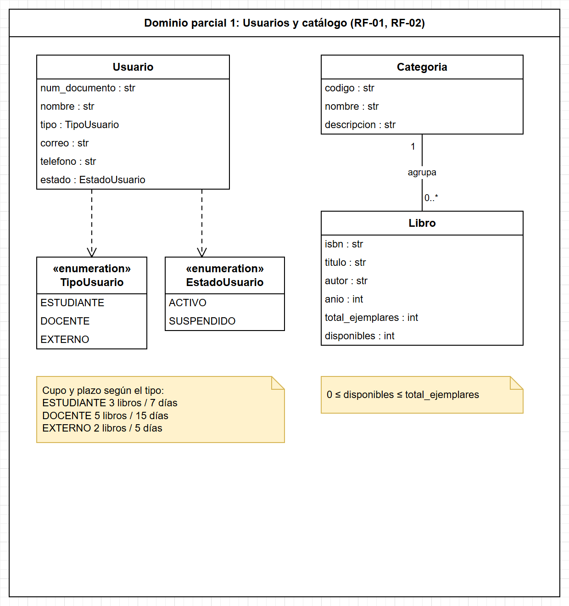

* **Usuario** con el tipo de cada atributo. `tipo` y `estado` no son texto libre: dependen de las
  enumeraciones **TipoUsuario** (ESTUDIANTE, DOCENTE, EXTERNO) y **EstadoUsuario** (ACTIVO, SUSPENDIDO); por eso
  se dibujan como dependencias punteadas hacia las cajas «enumeration».
* **Categoria `1` — `0..*` Libro**: la categoría agrupa los libros.
* Notas: la invariante `0 ≤ disponibles ≤ total_ejemplares` (nunca hay más disponibles que ejemplares) y la
  tabla de cupo/plazo por tipo de usuario.

### 2.2 Circulación: préstamos, multas y reservas (RF-03, RF-04)

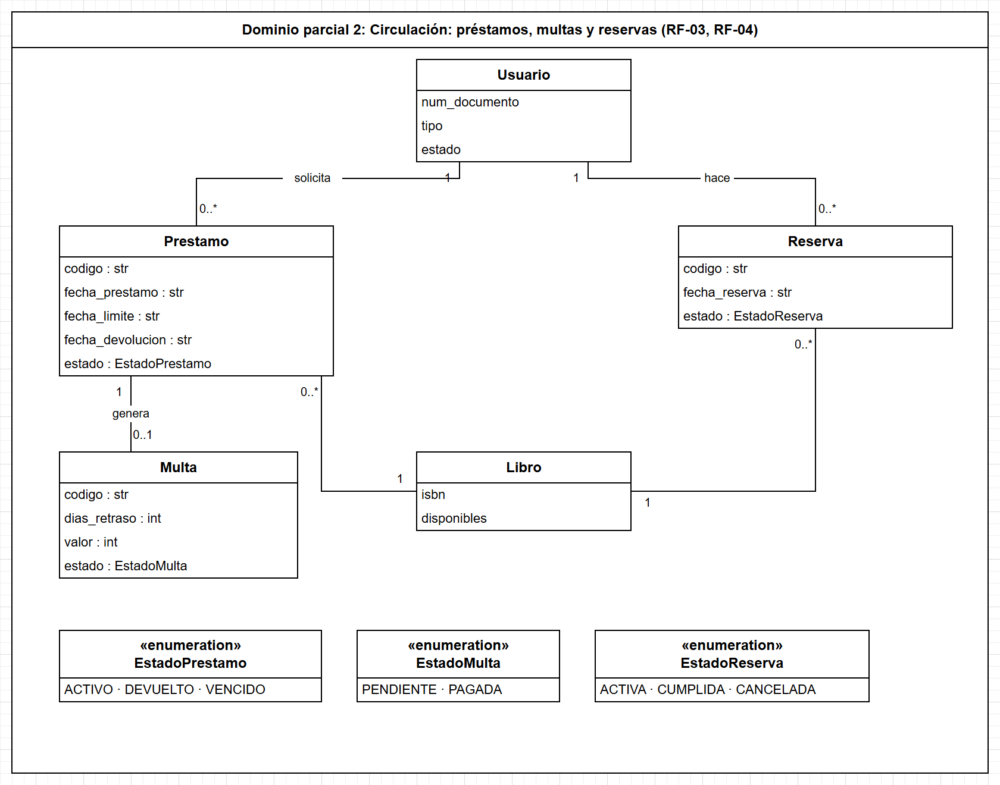

* Es el corazón del sistema: **Prestamo**, **Multa** y **Reserva** con sus tipos.
* Del usuario y del libro solo se muestran los atributos que importan aquí (`tipo` y `estado` del usuario para
  validar cupo y suspensión; `disponibles` del libro para saber si se puede prestar o reservar).
* Tres enumeraciones de estado:
  * **EstadoPrestamo**: ACTIVO → VENCIDO (si pasa la fecha límite sin devolverse) → DEVUELTO.
  * **EstadoMulta**: PENDIENTE → PAGADA.
  * **EstadoReserva**: ACTIVA → CUMPLIDA (cuando el usuario recibe el libro) o CANCELADA.

### 2.3 Análisis de datos (RF-05)

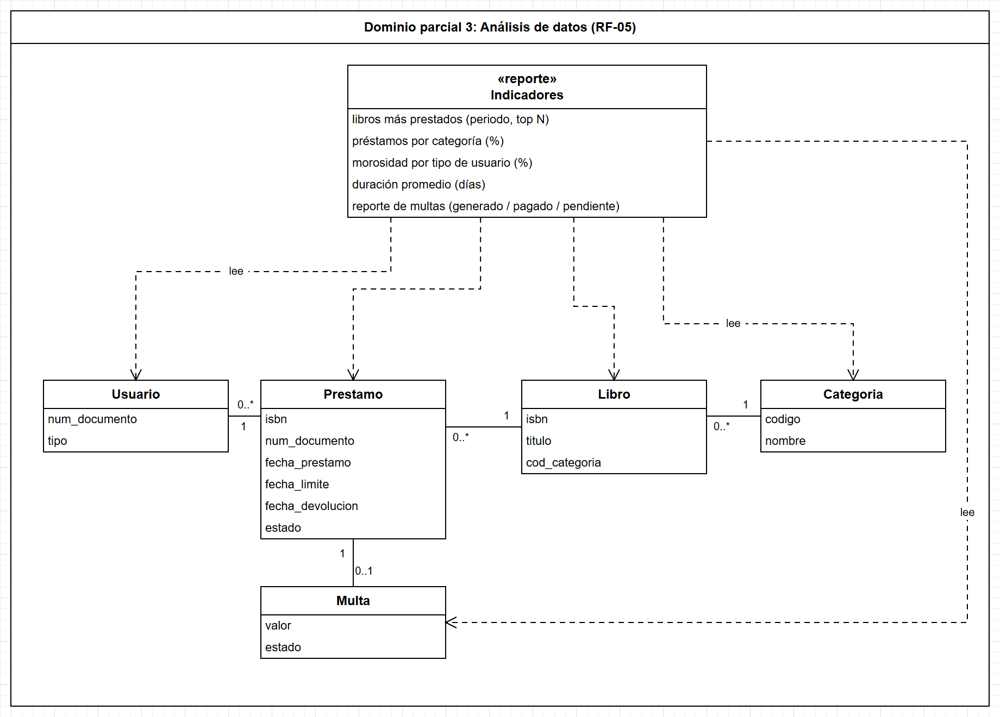

* La caja **«reporte» Indicadores** no es un archivo: representa los cinco indicadores que calcula el módulo de
  análisis (libros más prestados, préstamos por categoría, morosidad por tipo de usuario, duración promedio y
  reporte de multas).
* Las flechas punteadas **lee** indican de qué entidades sale la información, y las asociaciones de abajo
  indican **cómo se cruzan** los datos: el préstamo lleva al libro (`isbn`), el libro a su categoría
  (`cod_categoria`), el préstamo al usuario (`num_documento`, para saber su tipo) y la multa al préstamo
  (`cod_prestamo`).

---

## 3. Diagramas de clases (módulos de funciones)

Hay un diagrama por capa de la arquitectura de 3 capas (más la interfaz), en el mismo orden de las secciones
del notebook.

### 3.1 Capa Modelo (Sección 1 del notebook)

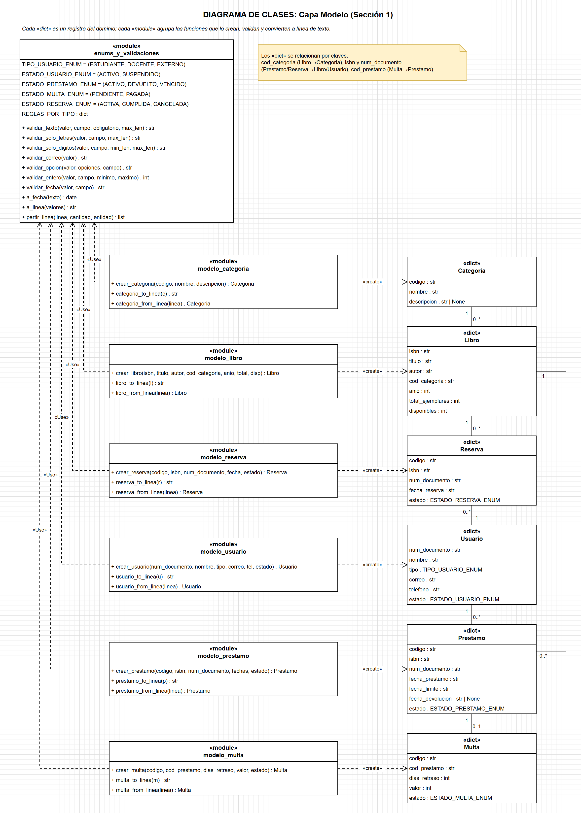

* **enums_y_validaciones** (arriba): contiene los "enums" (tuplas de valores permitidos), `REGLAS_POR_TIPO`
  y todas las funciones de validación que usa el sistema:
  `validar_texto` (no vacío, sin `|`, longitud máxima), `validar_solo_letras`, `validar_solo_digitos`,
  `validar_correo`, `validar_opcion`, `validar_entero`, `validar_fecha`, y las utilidades de conversión
  `a_fecha`, `a_linea` y `partir_linea`.
* **Seis «module» `modelo_*`** (centro): cada uno tiene tres funciones —
  `crear_<entidad>()` construye y valida el diccionario, `<entidad>_to_linea()` lo convierte en una línea del
  `.txt` y `<entidad>_from_linea()` hace lo contrario.
* **Seis «dict»** (derecha): la estructura exacta de cada diccionario con el tipo de cada clave. La flecha
  **«create»** indica qué módulo crea cada uno.
* Las flechas **«Use»** de la izquierda muestran que todos los módulos del modelo usan
  `enums_y_validaciones`.
* Las asociaciones entre los «dict» se hacen **por claves** (no por referencias): `cod_categoria`,
  `isbn`, `num_documento` y `cod_prestamo`.

### 3.2 Capa Repositorios (Sección 2)

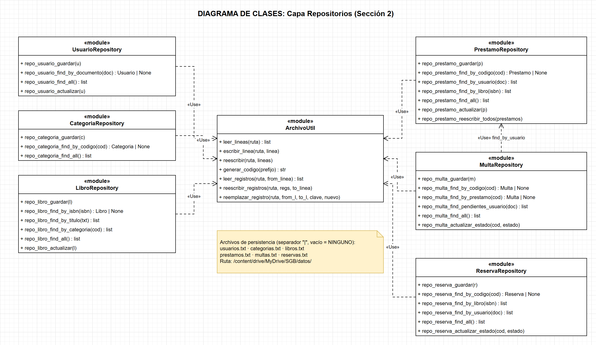

* **ArchivoUtil** (centro) es el único módulo que toca los archivos: `leer_lineas`, `escribir_linea`,
  `reescribir`, `generar_codigo` (códigos tipo `PRE-20261009090000002`) y tres ayudas genéricas
  (`leer_registros`, `reescribir_registros`, `reemplazar_registro`).
* **Seis repositorios** (`repo_<entidad>_*`), uno por archivo `.txt`. Todos siguen el mismo patrón:
  `guardar` (agrega una línea), `find_by_*` (busca), `find_all` (lee todo) y `actualizar` /
  `actualizar_estado` (reescribe el registro modificado).
* Todos usan **ArchivoUtil** («Use»). Además **MultaRepository usa PrestamoRepository** porque una multa no
  guarda el documento del usuario: para encontrar las multas pendientes de un usuario
  (`repo_multa_find_pendientes_usuario`) primero busca los préstamos de ese usuario.
* La nota recuerda el formato de persistencia: campos separados por `|`, vacíos como `NINGUNO`, en
  `/content/drive/MyDrive/SGB/datos/`.
* Esta capa **no aplica reglas de negocio**; solo lee y escribe.

### 3.3 Capa Servicios (Sección 3)

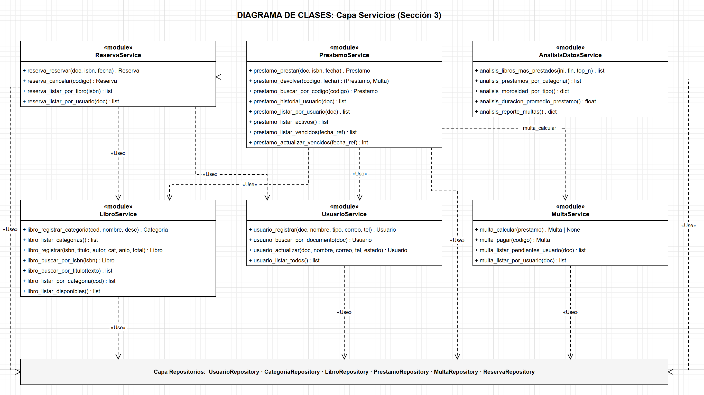

* Seis módulos con la lógica del negocio. Cada función valida las reglas y, si algo no se cumple, lanza
  `ValueError` con un mensaje claro que la interfaz muestra.
* Dependencias entre servicios (líneas «Use» entre cajas):
  * **PrestamoService → UsuarioService, LibroService, MultaService, ReservaService**: para prestar necesita
    saber si el usuario existe y está activo, si tiene multas, si el libro tiene ejemplares y si hay cola de
    reservas; al devolver llama a `multa_calcular()`.
  * **ReservaService → UsuarioService, LibroService**: para reservar valida al usuario y el libro.
* Todos los servicios usan la **Capa Repositorios** (caja gris inferior); `AnalisisDatosService` lee varios
  repositorios (préstamos, libros, categorías, usuarios y multas).

### 3.4 Capa Interfaz de usuario (Sección 4)

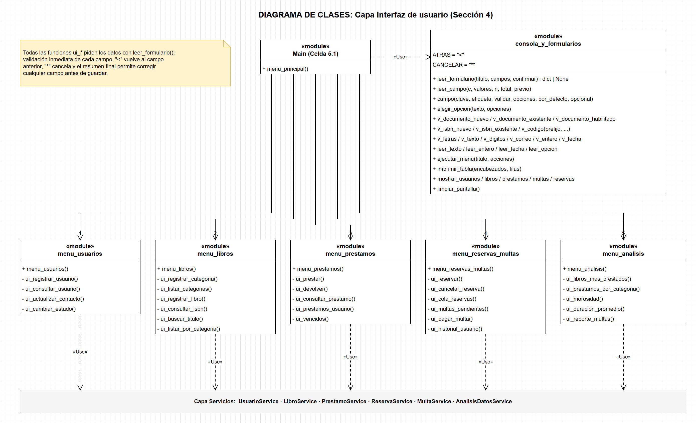

* **Main (Celda 5.1)** contiene `menu_principal()`, que navega (flechas 1 a 5) hacia los cinco submenús.
* Cada submenú (`menu_usuarios`, `menu_libros`, `menu_prestamos`, `menu_reservas_multas`, `menu_analisis`)
  tiene funciones internas `ui_*` (marcadas con `-`), una por opción del menú, y usa el servicio que le
  corresponde.
* **consola_y_formularios** reúne la infraestructura de entrada/salida:
  * `leer_formulario()` y `leer_campo()`: piden los datos **campo por campo**, validando cada uno en el
    momento; `<` vuelve al campo anterior y `*` cancela (constantes `ATRAS` y `CANCELAR`).
  * `elegir_opcion()`: para campos con opciones fijas (tipo de usuario, estado, categoría) muestra una lista
    numerada y solo acepta una de esas opciones.
  * Validadores `v_*`: `v_documento_nuevo/existente/habilitado`, `v_isbn_*`, `v_codigo`, `v_letras`,
    `v_digitos`, `v_correo`, `v_entero`, `v_fecha`.
  * `ejecutar_menu()`, `imprimir_tabla()`, `mostrar_*()` y `limpiar_pantalla()`.

---

## 4. Diagrama de objetos

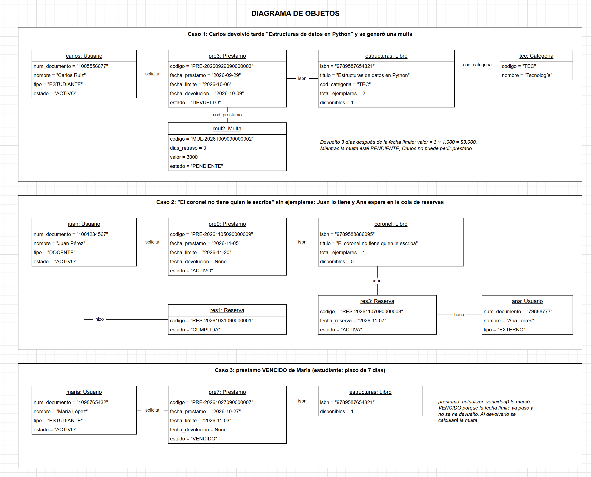

Muestra **instancias reales** (diccionarios concretos) tomadas de los datos de prueba de `SGB/datos/`, en tres
casos. El nombre de cada objeto está subrayado (`carlos: Usuario`) y en lugar de tipos aparecen valores.

* **Caso 1, multa por retraso:** `carlos` (estudiante) tuvo el préstamo `pre3` del libro `estructuras`
  (categoría `tec`). La fecha límite era 2026-10-06 y lo devolvió el 2026-10-09: 3 días tarde, así que se
  generó `mul2` por $3.000 en estado PENDIENTE. Mientras no la pague, Carlos no puede pedir préstamos.
* **Caso 2, cola de reservas:** el libro `coronel` tiene 1 ejemplar y 0 disponibles porque `juan` lo tiene
  prestado (`pre9`, ACTIVO). Juan lo había reservado antes (`res1`, ya CUMPLIDA). `ana` hizo la reserva `res3`
  (ACTIVA) y es la siguiente en la cola: cuando Juan devuelva el libro, solo Ana podrá llevárselo.
* **Caso 3, préstamo vencido:** `maria` tiene el préstamo `pre7` sin devolver y la fecha límite ya pasó, por
  lo que `prestamo_actualizar_vencidos()` lo marcó como VENCIDO. Cuando lo devuelva se calculará su multa.

---

# DISEÑO DE COMPORTAMIENTO

## 5. Diagrama estructurado

Igual que en la plantilla, el diagrama estructurado tiene tres partes: la estructura de módulos, la estructura
de llamadas entre funciones y el diseño (pseudocódigo) de cada función.

### 5.1 Estructura de módulos

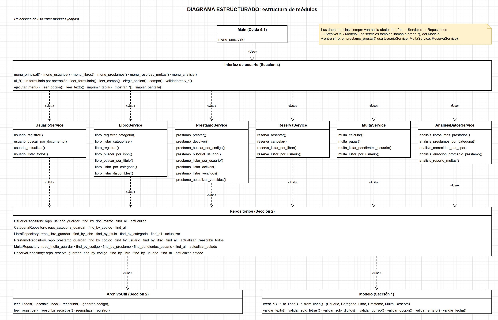

* Muestra las **capas** y las relaciones «Use» entre ellas, de arriba hacia abajo:
  **Main → Interfaz → los 6 Servicios → Repositorios → ArchivoUtil y Modelo**.
* Cada caja lista solo los nombres de sus funciones (sin parámetros), para ver de un vistazo qué hace cada módulo.
* Las dependencias van **siempre hacia abajo**: una capa nunca llama a la capa de arriba. Esa es la regla de la
  arquitectura de 3 capas (RNF-01).

### 5.2 Estructura de llamadas entre funciones

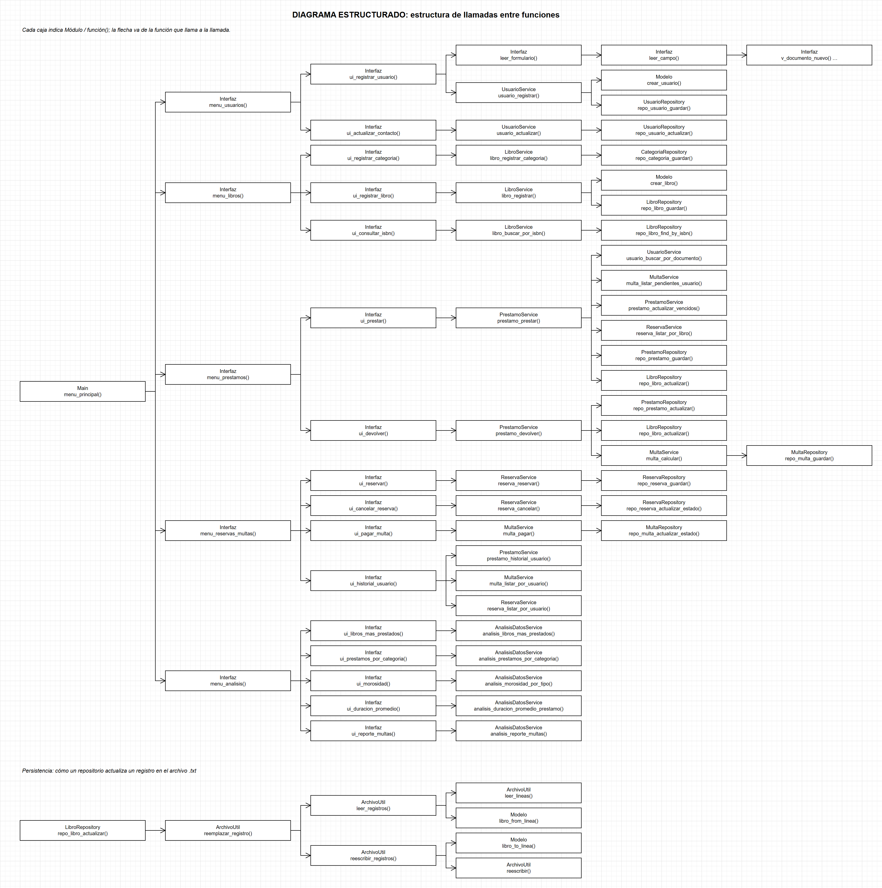

* Es un **árbol de llamadas** que se lee de izquierda a derecha: cada caja dice `Módulo / función()` y la
  flecha va desde la función que llama hacia la función llamada.
* Desde `menu_principal()` salen los cinco submenús; de cada submenú, las funciones `ui_*` de sus opciones;
  de ellas, los servicios; y de los servicios, el modelo y los repositorios. Por ejemplo:
  `menu_prestamos() → ui_prestar() → prestamo_prestar() → usuario_buscar_por_documento(),
  multa_listar_pendientes_usuario(), prestamo_actualizar_vencidos(), reserva_listar_por_libro(),
  repo_prestamo_guardar(), repo_libro_actualizar()`.
* El segundo árbol (abajo) muestra la **persistencia**: cómo `repo_libro_actualizar()` usa
  `reemplazar_registro()`, que lee el archivo (`leer_registros → leer_lineas, libro_from_linea`) y lo vuelve a
  escribir (`reescribir_registros → libro_to_linea, reescribir`).

### 5.3 Diseño de cada función (pseudocódigo)

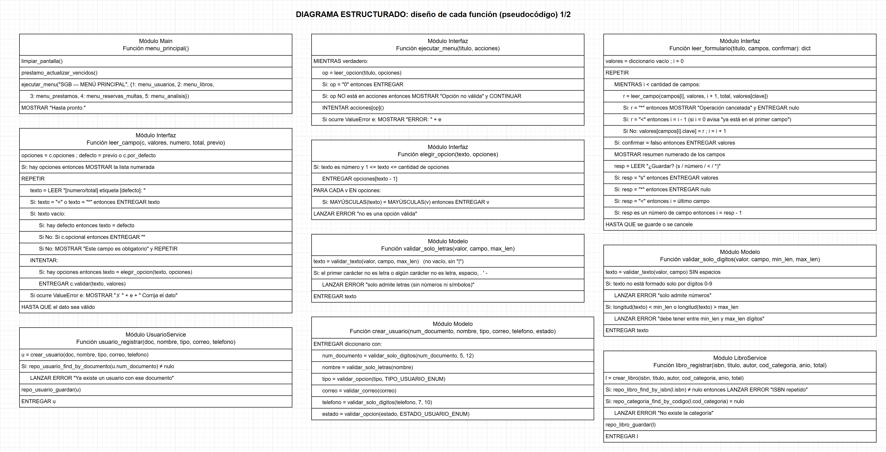

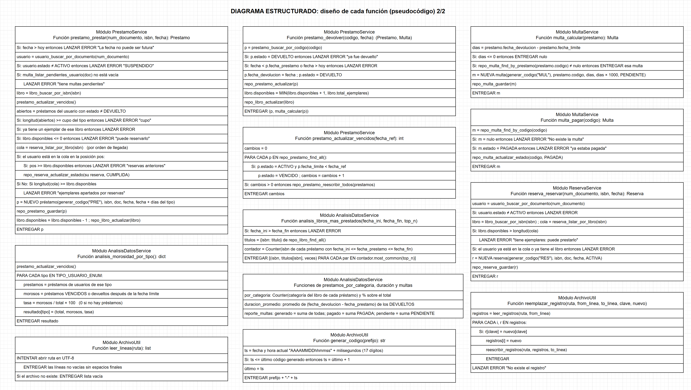

Cada caja tiene el título `Módulo X / Función Y()` y una fila por instrucción, con la misma notación de la
plantilla: **Si / Si No**, **MIENTRAS**, **REPETIR … HASTA QUE**, **PARA CADA**, **LEER**, **MOSTRAR**,
**ENTREGAR** (retornar), **LANZAR ERROR** (`raise ValueError`) y **NUEVO** (crear un registro). La sangría
indica qué instrucciones están dentro de un bloque.

Funciones documentadas y lo más importante de cada una:

* **menu_principal / ejecutar_menu**: actualizan los vencidos, muestran el menú en un ciclo y atrapan los
  `ValueError` para mostrar el error sin detener el programa.
* **leer_formulario / leer_campo / elegir_opcion**: el mecanismo de captura de datos. Cada campo se repite
  hasta que sea válido; `<` retrocede un campo, `*` cancela todo y el resumen final permite corregir cualquier
  campo por su número antes de guardar.
* **validar_solo_letras / validar_solo_digitos / crear_usuario**: cómo se rechazan números en campos de texto,
  letras en campos numéricos y longitudes incorrectas.
* **usuario_registrar / libro_registrar**: validan, verifican que no exista el registro (y que exista la
  categoría) y guardan.
* **prestamo_prestar**: todas las reglas del préstamo en orden (fecha no futura, usuario ACTIVO, sin multas,
  cupo, disponibilidad y cola de reservas por orden de llegada) y el cálculo de `fecha_limite` según el tipo.
* **prestamo_devolver / multa_calcular / multa_pagar**: la devolución libera el ejemplar y, si hubo retraso,
  crea la multa de `días × 1.000`; el pago la pasa a PAGADA.
* **prestamo_actualizar_vencidos**: marca VENCIDO todo préstamo ACTIVO cuya fecha límite ya pasó.
* **reserva_reservar**: solo permite reservar si no hay ejemplares libres para el usuario.
* **analisis_***: cómo se calcula cada indicador (con `Counter`, porcentajes y promedios).
* **reemplazar_registro / generar_codigo / leer_lineas**: la persistencia en los `.txt`.

---

# DISEÑO DE INTERACCIÓN

## 6. Diagramas de secuencia

Cada diagrama de secuencia describe **una función** (título `Módulo X / Función: y()`) y muestra, en orden de
arriba hacia abajo, los mensajes entre las partes del sistema que participan. Las cajas superiores son las
**líneas de vida** (`:PrestamoService` = el módulo en ejecución) y los rectángulos delgados son el tiempo en que
cada función está activa.

### 6.1 `menu_principal()`

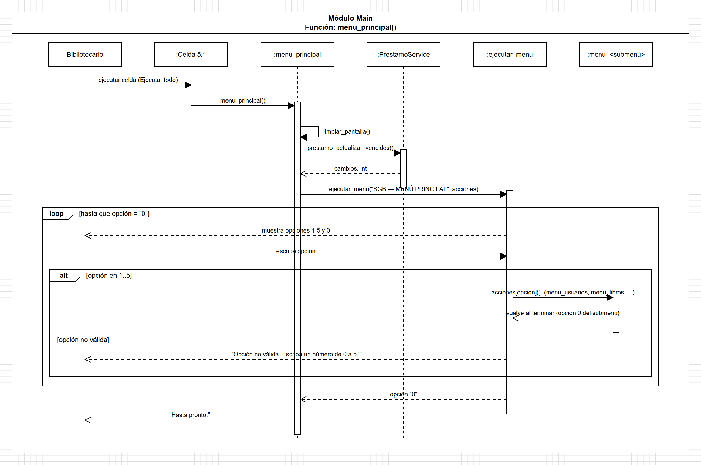

El usuario ejecuta la celda 5.1; `menu_principal()` limpia la pantalla, actualiza los préstamos vencidos y
llama a `ejecutar_menu()`. Dentro del **loop** (hasta que la opción sea "0") se muestran las opciones, el
usuario escribe una y un **alt** decide: si la opción está entre 1 y 5 se abre el submenú correspondiente;
si no, se muestra "Opción no válida". Al salir se imprime "Hasta pronto.".

### 6.2 Formularios con validación: `ui_registrar_usuario()` → `leer_formulario()`

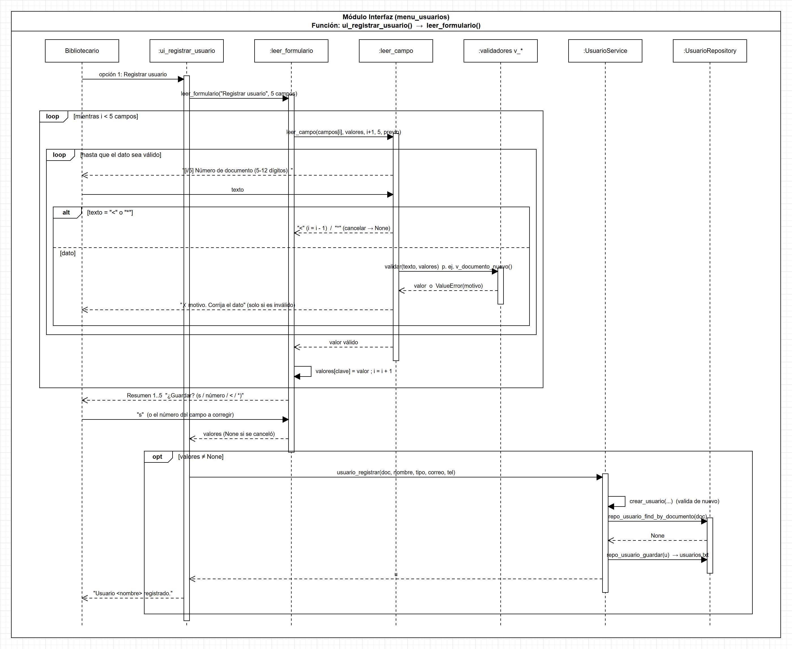

Es el comportamiento común de **todos** los formularios del sistema:

1. `ui_registrar_usuario()` llama a `leer_formulario()` con los 5 campos.
2. **loop externo**: por cada campo se llama a `leer_campo()`.
3. **loop interno**: se pide el dato hasta que sea válido. Un **alt** distingue:
   * si el usuario escribe `<` o `*`, se devuelve esa orden (`<` retrocede al campo anterior, `*` cancela);
   * si escribe un dato, se envía al validador `v_*` correspondiente, que devuelve el valor convertido o un
     `ValueError` con el motivo; si es inválido se muestra "✗ motivo. Corrija el dato" y se vuelve a pedir
     **solo ese campo**.
4. Con todos los campos completos se muestra el **resumen**; el usuario confirma con `s` o escribe el número
   del campo que quiere corregir.
5. **opt** (solo si no se canceló): se llama a `usuario_registrar()`, que valida de nuevo con
   `crear_usuario()`, verifica que el documento no exista y guarda en `usuarios.txt`.

### 6.3 `prestamo_prestar()`

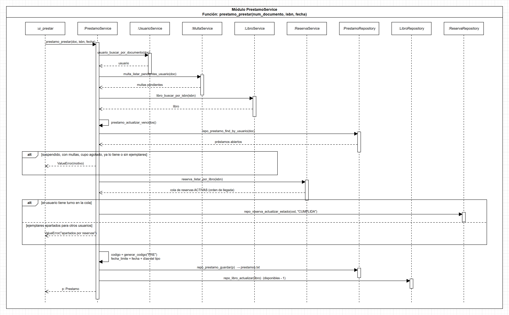

`PrestamoService` consulta al usuario, sus multas pendientes y el libro; actualiza los vencidos y trae los
préstamos abiertos del usuario. El primer **alt** corta el proceso con `ValueError` si el usuario está
suspendido, tiene multas, alcanzó su cupo, ya tiene ese libro o no hay ejemplares. Luego revisa la **cola de
reservas**: si el usuario tiene el turno, su reserva pasa a CUMPLIDA; si los ejemplares están apartados para
otros, se rechaza. Finalmente genera el código, calcula la fecha límite, guarda el préstamo y descuenta un
ejemplar disponible.

### 6.4 `prestamo_devolver()`

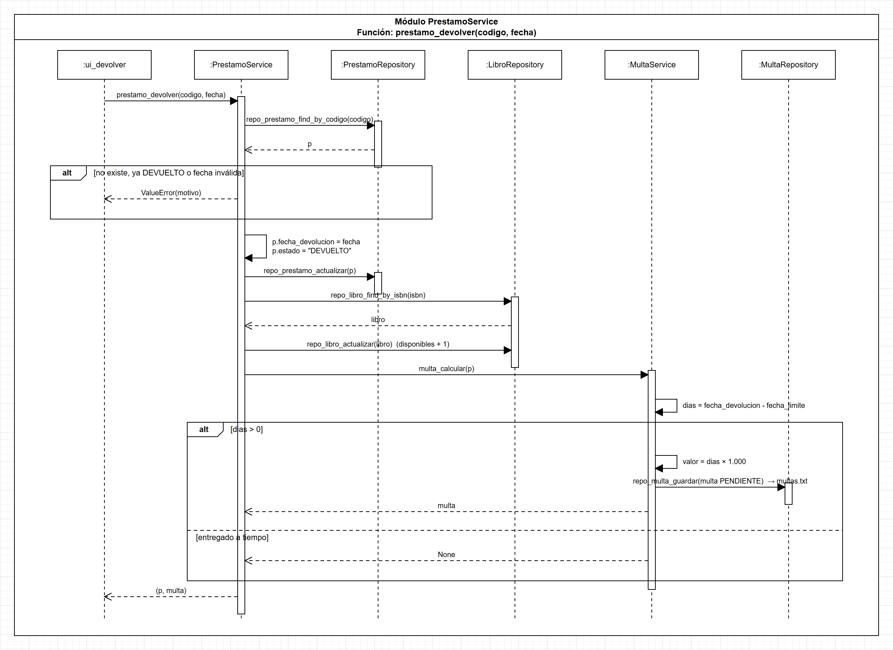

Busca el préstamo (y rechaza si no existe, ya fue devuelto o la fecha es inválida), registra la fecha de
devolución y el estado DEVUELTO, suma un ejemplar disponible al libro y llama a `multa_calcular()`. El
**alt** muestra las dos salidas: si hubo días de retraso se crea y guarda una multa PENDIENTE de
`días × 1.000`; si se entregó a tiempo no hay multa (`None`). Devuelve el par `(préstamo, multa)`.

### 6.5 `reserva_reservar()`

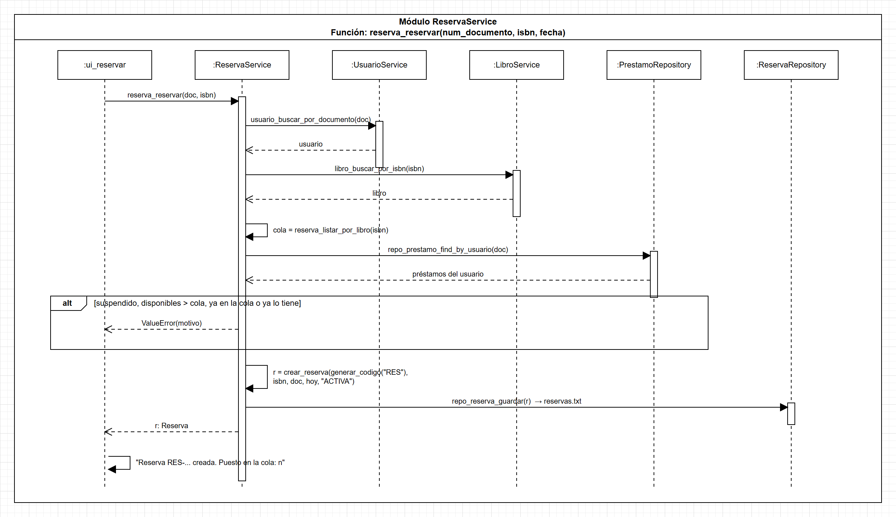

Valida al usuario y el libro, obtiene la cola de reservas activas y los préstamos del usuario. Rechaza si el
usuario está suspendido, si hay más ejemplares disponibles que reservas en cola (entonces debe prestarlo
directamente), si ya está en la cola o si ya tiene el libro. Si todo está bien crea la reserva ACTIVA con
código `RES-…` y la guarda; la interfaz informa el puesto en la cola.

### 6.6 `multa_pagar()`

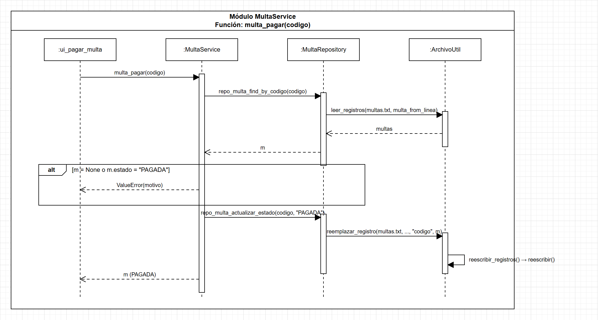

Muestra la interacción con la persistencia: `MultaRepository` usa `ArchivoUtil` para leer `multas.txt`; si la
multa no existe o ya estaba pagada se rechaza; si no, `repo_multa_actualizar_estado()` usa
`reemplazar_registro()`, que reescribe el archivo con la multa en estado PAGADA.

### 6.7 `analisis_libros_mas_prestados()`

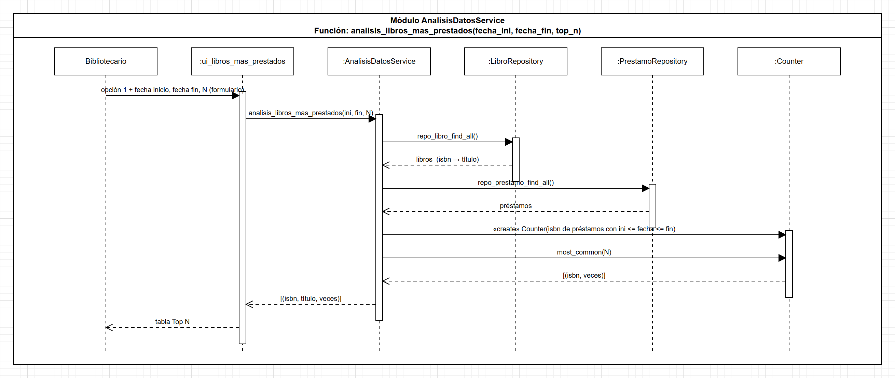

El usuario ingresa el periodo y N con un formulario. El servicio lee los libros (para obtener los títulos) y
los préstamos, crea un `Counter` con los ISBN prestados dentro del periodo, pide los `most_common(N)` y
devuelve la lista `(isbn, título, veces)` que se muestra como tabla.

### 6.8 `analisis_morosidad_por_tipo()`

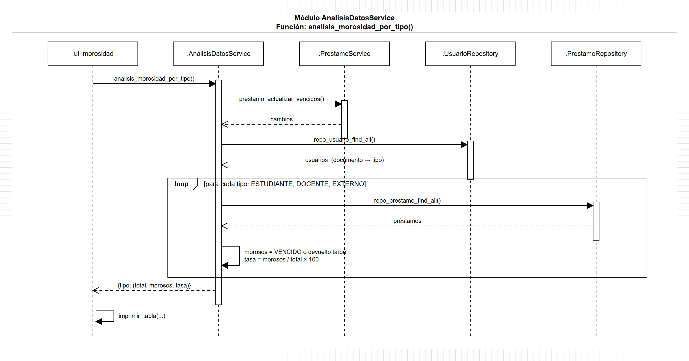

Primero actualiza los préstamos vencidos (para que el cálculo esté al día) y lee los usuarios para saber el
tipo de cada uno. En el **loop** por cada tipo (ESTUDIANTE, DOCENTE, EXTERNO) cuenta los préstamos morosos
(VENCIDOS o devueltos después de la fecha límite) y calcula `tasa = morosos / total × 100`. Devuelve un
diccionario `{tipo: (total, morosos, tasa)}` que la interfaz imprime como tabla.

---

## Cómo editar o actualizar los diagramas

1. Abrir [`SGB_UML.drawio`](SGB_UML.drawio) en [app.diagrams.net](https://app.diagrams.net) o en la extensión
   *Draw.io Integration* de VS Code. Cada diagrama está en su propia pestaña (abajo).
2. Para exportar una imagen: *Archivo → Exportar como → PNG* (marcando "Cuadrícula" si se quiere el mismo
   fondo de la plantilla) y reemplazar el archivo correspondiente en `diagramas/`.
